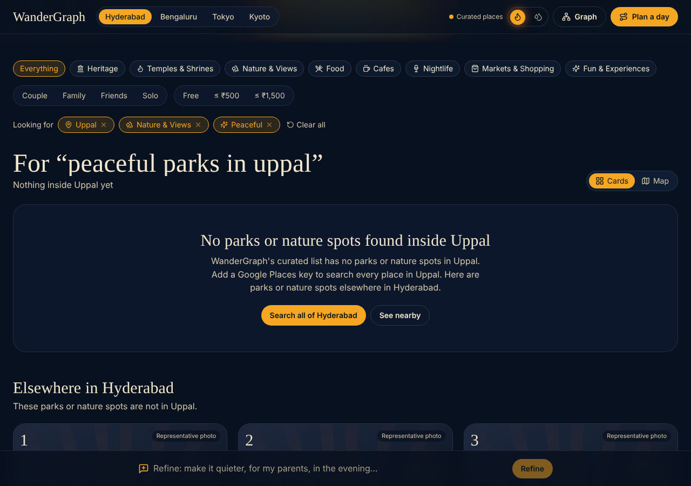
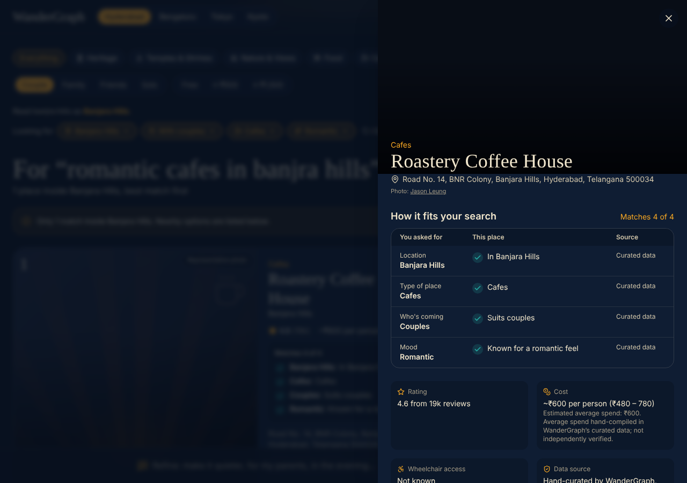
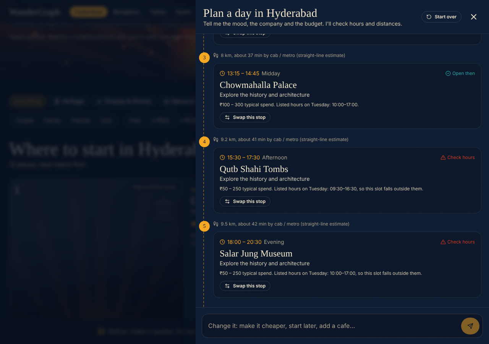
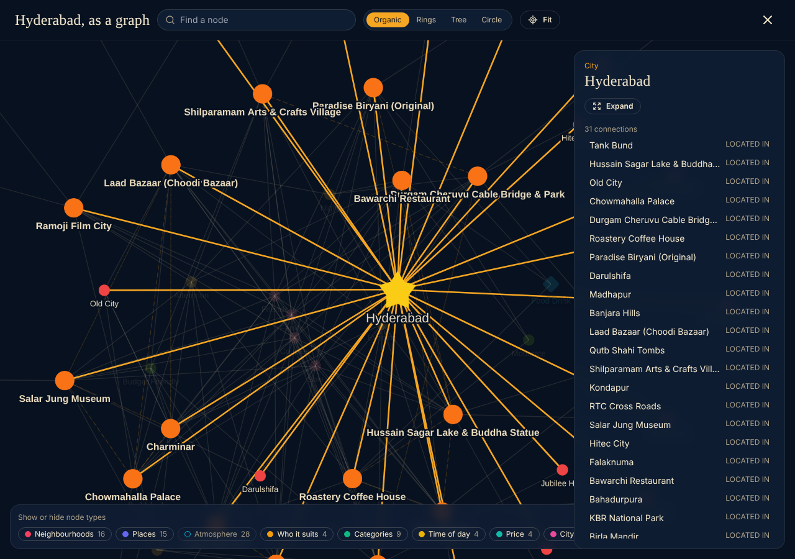
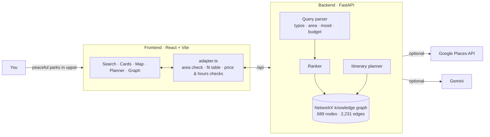

<div align="center">

# WanderGraph

**Describe the outing you want. Get places that actually fit, and see why.**

A knowledge-graph place finder and day planner for **Hyderabad**, **Bengaluru**, **Tokyo** and **Kyoto**.

### [🔥 Try it live → wandergraph-six.vercel.app](https://wandergraph-six.vercel.app/)



</div>

---

## What it does

Type something like **"peaceful parks in Uppal"**, **"romantic cafes in Banjara Hills under 1000 for two"** or **"temples in Kyoto"**. WanderGraph:

1. **Reads your request.** It picks out the area, type of place, mood, who's coming, time of day and budget, and fixes typos ("banjra hills" → Banjara Hills, "hydrabad" → Hyderabad).
2. **Stays where you asked.** Results are limited to the area you named. If nothing there fits, it says so plainly and shows the closest matches elsewhere in the city, each with its distance.
3. **Shows why each place is listed.** Every result has a checklist: *location ✓, type ✓, mood ✓, budget ?*. It also says where each fact came from: Google, the curated data, or unknown.
4. **Plans a day.** Ask for "a full day of Nizami heritage". You get a timed route with travel distances, warnings for stops that are closed at their planned time, and one-click swaps.
5. **Lets you explore the graph.** Every city is a knowledge graph of places, areas, categories, moods and companions that you can click through.

## Screenshots

| How each place fits your search | A day plan with hours and distances checked |
|:---:|:---:|
|  |  |

| The city as a knowledge graph |
|:---:|
|  |

## Features

**Search**
- Free-text search, with a separate **refine** box for follow-ups ("make it quieter", "for my parents").
- Filter buttons for categories (Heritage, Temples & Shrines, Nature & Views, Food, Cafes, Nightlife, Markets, Fun), companions and budget.
- Removable **"Looking for"** chips. A chip you remove stays removed.
- Naming a city in the text switches to it: "temples in kyoto" works from the Hyderabad page.
- Cards and map views (Leaflet), with the searched area marked on the map.

**Honest data**
- Each place shows where its data comes from: *Google Places* (live) or *hand-curated by WanderGraph*.
- "Open now" is shown only when Google reports it.
- Prices are in the city's currency: ₹ for India, ¥ for Japan. Monument entry fees never appear on restaurants.
- Photos come from Google Places when an API key is set, and are credited to their authors.

**Day planner**
- Plans in plain English, then lets you change it: "make it cheaper", "start later", "add a cafe".
- Checks each stop against its listed opening hours for that day of the week.
- Shows straight-line distance and rough travel time between stops.
- Flags "meal" slots that aren't at a place that serves food.
- Uses Google Gemini when `GEMINI_API_KEY` is set, and falls back to a rule-based planner otherwise.

**Design**
- A "fire & water" theme with an animated ember/ripple hero. Toggle between fire (dark, saffron) and water (teal).
- Works on phones and is keyboard-friendly, with focus states, ARIA labels and reduced-motion support.

## How it works



- **Backend** (`backend/`): FastAPI and Pydantic. The knowledge graph is a NetworkX `MultiDiGraph` built at startup from `backend/app/data/`, holding 76 hand-curated places (about 20 per city). Node types include City, Neighbourhood, Category, Atmosphere, CompanionType, PriceRange and TimeOfDay. With a Google key, live Google Places results are added to the curated ones.
- **Frontend** (`frontend/`): React 18, TypeScript, Tailwind, Cytoscape.js for the graph and Leaflet for maps. `src/adapter.ts` keeps results inside the area you asked for, builds the fit checklist and checks planner hours.

## Run it locally

**You need:** Python 3.10+ and Node 18+.

**1. Backend (terminal 1)**
```bash
cd backend
python3 -m venv venv
source venv/bin/activate          # Windows: venv\Scripts\activate
pip install -r requirements.txt
cp .env.example .env              # then add your keys (optional)
python -m uvicorn app.main:app --host 127.0.0.1 --port 8000 --reload
```
The API runs at http://127.0.0.1:8000, with interactive docs at http://127.0.0.1:8000/docs.

**2. Frontend (terminal 2)**
```bash
cd frontend
npm install
npm run dev
```
Open **http://localhost:5173**. The dev server passes `/api` requests to the backend on port 8000.

**3. Keys (optional).** Add them to `backend/.env`:

| Variable | What it enables | Without it |
|---|---|---|
| `GOOGLE_MAPS_API_KEY` | Live Google Places results, photos and opening status | Curated places only, with placeholder images |
| `GEMINI_API_KEY` | AI-written day plans | Rule-based day plans |

> Never commit `.env`. It's already in `.gitignore`. On a hosting platform, set keys in its environment-variable settings instead.

## Deploy

### Vercel (what the live site uses)
1. Import the repo at [vercel.com/new](https://vercel.com/new).
2. Set **Application Preset** to **Other**, not "Services", and leave **Root Directory** as `./`. The included `vercel.json` handles the build and sends `/api/*` to the FastAPI function in `api/index.py`.
3. Add `GOOGLE_MAPS_API_KEY` (and optionally `GEMINI_API_KEY`) under **Environment Variables**.
4. Click **Deploy**. Every push to `main` redeploys automatically.

> The backend keeps search sessions and day plans in memory. On serverless hosting the function can restart between requests. If that happens, "Swap this stop" asks you to request the plan again. For an always-on backend, use Render.

### Render
`render.yaml` sets up the backend as a web service and the frontend as a static site. In the Render dashboard choose **New → Blueprint**, pick this repo and enter your keys.

### Docker
```bash
docker compose up --build
```

## Tests

```bash
cd backend  && python -m pytest -q     # 24 tests
cd frontend && npm test                # 33 tests
```
The frontend tests replay responses recorded from the real backend (`frontend/tests/api-recorded.json`). They cover area handling, typo corrections, chip removal, following a city named in the text, price clean-up and the planner's hours checks.

## Project structure

```
wandergraph/
├── api/index.py            # Vercel entry point → FastAPI app
├── backend/
│   └── app/
│       ├── api/            # REST routes (/search, /preferences, /itinerary, /graph, /places)
│       ├── data/           # curated places, cities, categories
│       ├── graph/          # knowledge-graph builder
│       └── services/       # parser, ranker, Google Places, images, itinerary
├── frontend/
│   ├── src/
│   │   ├── adapter.ts      # area check, fit table, price & hours checks
│   │   ├── api.ts          # typed API client
│   │   ├── hooks.ts        # search and planner state
│   │   └── components/     # Hero, PlaceCard, PlaceDrawer, Planner, GraphOverlay, MapView…
│   └── tests/
├── docs/                   # architecture, API, data sources, data policy
└── vercel.json · render.yaml · docker-compose.yml
```

## Docs

- [Architecture](docs/architecture.md)
- [API reference](docs/api.md)
- [Data sources & provenance](docs/data_sources.md)
- [Google Maps Platform data policy](docs/data_policy.md)
- [Developer guide](docs/development.md)

## Known limits

- The curated set is small, about 20 places per city. Add a Google key for full coverage.
- Without a Google key, "inside the area" is judged from each place's address, because the curated data has no area boundaries.
- Travel times are straight-line estimates, not routed directions.

## License

MIT © 2026 WanderGraph contributors.
